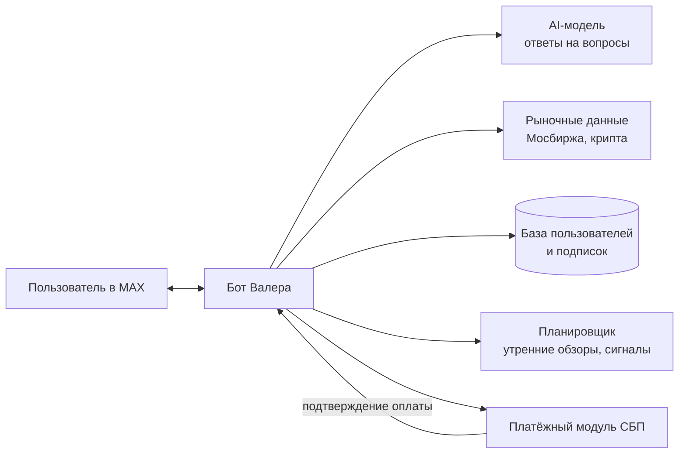
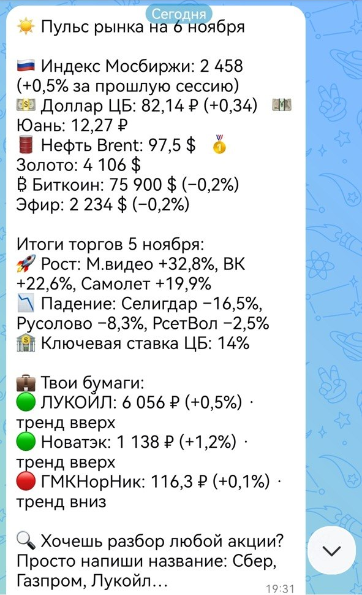
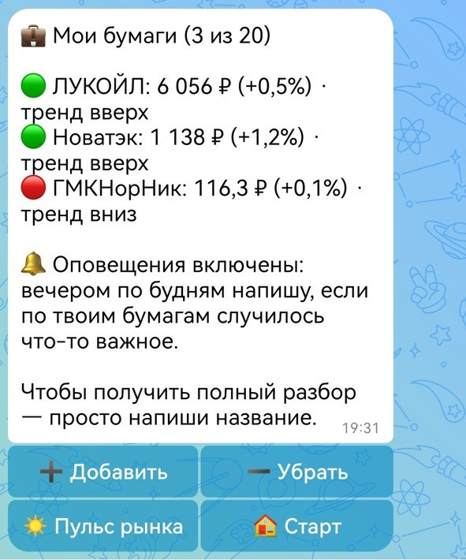
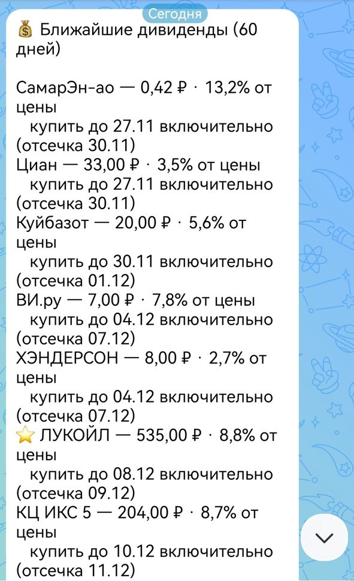
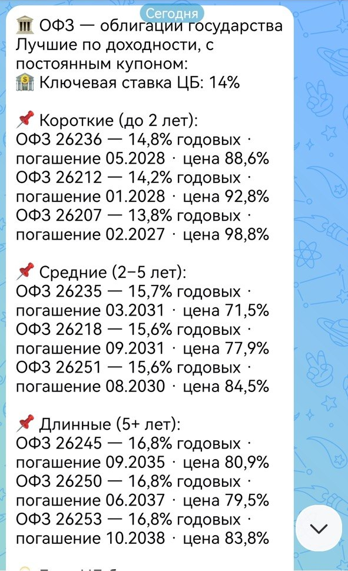

# Валера | Инвест-помощник

**AI-бот для частного инвестора в мессенджере MAX.**
Утренний пульс рынка, слежение за своими бумагами, дивиденды, ОФЗ и ответы на вопросы о крипте и Московской бирже — прямо в чате, без сайтов и приложений.

> ⚠️ Это витрина проекта. Исходный код коммерческий и в открытый доступ не выкладывается.
> Здесь показано, что умеет бот и как он устроен.

🤖 Бот: [max.ru/id5007110001_bot](https://max.ru/id5007110001_bot)

---

## Для кого

Для начинающих инвесторов (неквалифицированных), которым нужна понятная информация по инструментам, доступным через российских брокеров: акции Мосбиржи, ОФЗ, криптовалюта.

## Что умеет

| Функция | Доступ |
|---|---|
| ☀️ **Пульс рынка** к открытию биржи: индекс Мосбиржи, доллар и юань ЦБ, нефть, золото, биткоин и эфир, лидеры роста и падения, ключевая ставка | Бесплатно |
| 💼 **Мои бумаги**: личный список до 20 акций с ценой и направлением тренда | Подписка |
| 🔔 **Вечерние оповещения** по будням, если по бумагам из списка случилось что-то важное | Подписка |
| 🔍 **Разбор любой акции** — достаточно написать название (Сбер, Газпром, Лукойл…) | Бесплатно / по подписке |
| 💰 **Дивидендный радар**: ближайшие выплаты на 60 дней, доходность и дата «купить до» | Подписка |
| 🏛 **ОФЗ**: лучшие облигации по доходности — короткие, средние и длинные | Подписка |
| 🔥 Необычные объёмы торгов | Подписка |
| 📈 Обновления годовых максимумов и минимумов | Подписка |
| 🧭 Скринер бумаг в сильном тренде | Подписка |

Оплата подписки — через **СБП** прямо из чата, доступ открывается автоматически после оплаты.

## Как устроено

## Технологии

- **Python**, асинхронная архитектура
- **MAX Bot API** (библиотека aiomax)
- **LLM** для ответов на вопросы пользователей
- **СБП** — приём платежей через банк с автоматическим подтверждением
- Собственная база данных пользователей и подписок
- Планировщик задач для рассылок по расписанию
- Развёрнут на собственном **Linux VPS** как системный сервис (работает 24/7, автоперезапуск)

## Скриншоты

| Пульс рынка | Мои бумаги |
|---|---|
|  |  |

| Дивиденды | ОФЗ |
|---|---|
|  |  |

---

## Нужен похожий бот?

Делаю ботов под ключ для MAX и Telegram: приём оплаты, AI-ответы, рассылки, аналитика.

📩 Связаться: [logo177@mail.ru](mailto:logo177@mail.ru)
